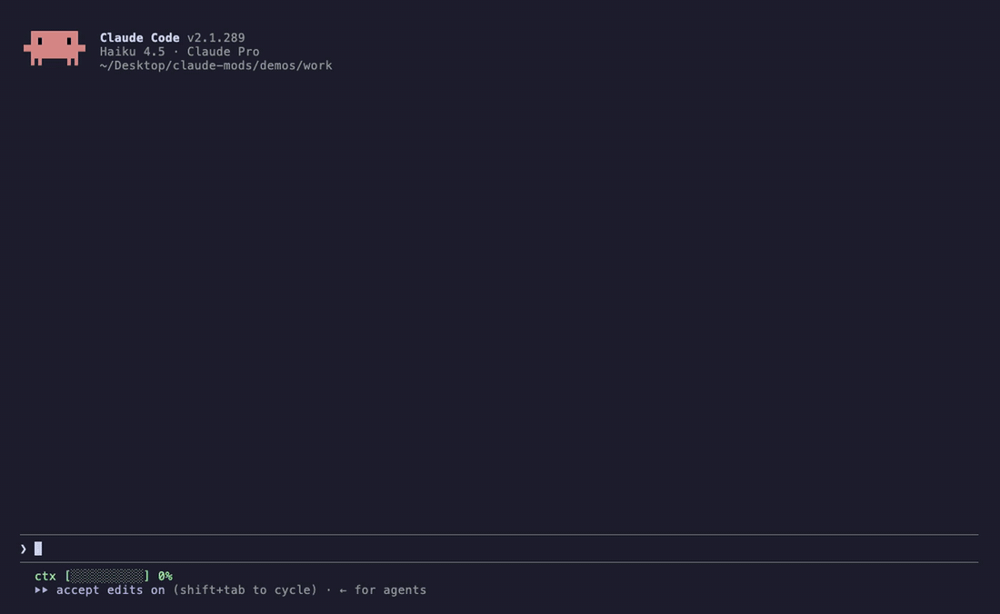

# teach-me

**Learn while Claude codes.** A [Claude Code](https://code.claude.com) mod.



A real, unedited session: Claude adds a cache, teach-me asks why (in Hinglish here; English is a setting), `/a 1` answers it.

After a turn that changed code, a small model (Haiku) writes **one multiple-choice question about that exact change**: the idea behind it, not trivia. It sits above the prompt until you answer. Scores are kept per concept, so `/teach stats` tells you what to revise.

Built for the way a lot of us code now: the agent writes it, you still have to understand it.

## Commands

- `/a 1-4` answer, `/a skip` see the answer
- `/teach stats` your weak spots, `/teach now` a question about the last change
- `/teach on`, `/teach off`

## Settings

`/plugin configure teach-me@nerfsaksham-teach-me`: quiz language (Hinglish or English), quiz model (default `haiku`), minutes between questions (default 4, so it never nags).

## What it touches

Its own store, and one Haiku call per question. Nothing else.

## Install

Claude Code **2.1.287 or newer** runs mods out of the box. On 2.1.273 to 2.1.286, start it with `CLAUDE_CODE_ENABLE_FUNCTION_HOOKS=1` first.

```bash
claude plugin marketplace add saksham10arora-dotcom/claude-teach-me
claude plugin install teach-me@nerfsaksham-teach-me
```

Every option has a default, so the installer's "userConfig options not yet set" note is safe to ignore.

Or try it without installing:

```bash
git clone https://github.com/saksham10arora-dotcom/claude-teach-me && claude --plugin-dir claude-teach-me
```

## Develop

```bash
claude plugin validate .
claude plugin test .
```

## More mods

Part of a set: [teach-me](https://github.com/saksham10arora-dotcom/claude-teach-me) · [vhs](https://github.com/saksham10arora-dotcom/claude-vhs) · [frugal](https://github.com/saksham10arora-dotcom/claude-frugal) · [lofi](https://github.com/saksham10arora-dotcom/claude-lofi). More community mods: [awesome-claude-mods](https://github.com/saksham10arora-dotcom/awesome-claude-mods).

MIT. Made by [Saksham Arora](https://saksham.digital) ([@nerfsaksham](https://x.com/nerfsaksham)).
